<p align="center">
  
</p>

<h1 align="center">Whip</h1>

<p align="center">
  <strong>Run your Herdr workflow from your phone or tablet.</strong><br>
  Chat with Claude Code, Codex, and OpenCode, review their changes, and work in remote terminals from a native Android or iOS interface.
</p>

<p align="center">
  <a href="https://github.com/kosumic/whip/actions/workflows/ci.yml"></a>
  <a href="https://github.com/kosumic/whip/actions/workflows/codeql.yml"></a>
  <a href="LICENSE"></a>
  <a href="https://expo.dev"></a>
  <a href="https://www.rust-lang.org/"></a>
  <a href="https://nodejs.org/"></a>
  <a href="https://x.com/Kosumi1989"></a>
</p>

<p align="center">
  <a href="https://apps.apple.com/us/app/whip-herd/id6808226150"></a>
  <a href="https://play.google.com/store/apps/details?id=io.github.kaminarios.whip"></a>
</p>

<p align="center">
  <a href="https://kosumic.github.io/whip/"></a>
</p>

<p align="center">
  <a href="https://youtu.be/M7oXwtNDbpI"></a><br>
  <a href="https://youtu.be/M7oXwtNDbpI"><strong>Watch the Whip launch video</strong></a>
</p>

Whip gives [Herdr](https://github.com/herdrdev/herdr) a touch-friendly mobile interface without exposing Herdr itself to the network. **Whip requires zero extra installation on the Herdr server.** It connects to your machine over SSH—directly or through saved jump hosts, ideally over Tailscale—and rebuilds the management experience as native screens. Watch the whole herd, follow Claude Code, Codex, and OpenCode conversations, dictate a prompt, review a Git diff, or attach to a full terminal. Plain SSH hosts work too, with multiple independent shell tabs even without Herdr.

With **Reverse Control**, a remote Claude Code, Codex or OpenCode agent can also use Whip's browser and phone tools, inspect connected hosts, and coordinate other Herdr agents through the same SSH connections.

**Native terminal delivery:** Rust sends output directly to the Android or iOS WebView running xterm.js. Normal frames and write-completion credits bypass the React Native JavaScript thread. [Architecture and measurements](#performance).

The app separates connection management from daily supervision: **Hosts** manages saved SSH endpoints, saved chats, and browser access; **Herd** brings connected agents into a searchable, scoped queue; **Terminal** keeps pane sessions, SSH shells, and native Chat View within reach; and **More** holds security, notification, appearance, and terminal preferences.

Whip is not developed, maintained, or endorsed by the Herdr project or its authors.

## Contents

- [Opinionated by design](#opinionated-by-design)
- [Preview](#preview)
- [What you can do](#what-you-can-do)
  - [Supervise Herdr](#supervise-herdr)
  - [Use Chat View](#use-chat-view)
  - [Browse websites and remote previews](#browse-websites-and-remote-previews)
  - [Give agents Reverse Control](#give-agents-reverse-control)
  - [Work in terminals](#work-in-terminals)
  - [Move files and attachments](#move-files-and-attachments)
  - [Review Git changes](#review-git-changes)
  - [Connect securely](#connect-securely)
  - [Make it yours](#make-it-yours)
- [Install Whip](#install-whip)
  - [Android](#android)
  - [iOS](#ios)
- [Connect your first host](#connect-your-first-host)
  - [Pair with a QR code](#pair-with-a-qr-code)
  - [Enter a host manually](#enter-a-host-manually)
- [How it works](#how-it-works)
- [Performance](#performance)
- [Architecture](#architecture)
  - [React Native Frontend](#react-native-frontend)
  - [Whip Rust Core](#whip-rust-core)
- [Development](#development)
  - [EAS builds](#eas-builds)
  - [App Store publishing](#app-store-publishing)
  - [App versions and release tags](#app-versions-and-release-tags)
  - [Google Play publishing](#google-play-publishing)
  - [Validation](#validation)
- [Community](#community)
- [Credits](#credits)
- [License](#license)

## Opinionated by design

Whip is opinionated: **Herdr is the only tool that will receive first-class support.** Our native supervision, navigation, and agent workflows are built around Herdr's hosts, spaces, tabs, and panes.

Herdr is optional for ordinary SSH work: connect to a host and open independent login-shell tabs, browse files, or forward a web preview.

We will not add first-class support for **tmux, Zellij, or Mosh**. This focus lets us build a cohesive mobile experience for Herdr.

## Preview

<table>
  <tr>
    <td align="center"></td>
    <td align="center"></td>
  </tr>
  <tr>
    <td align="center"><strong>Manage every host</strong><br>See live connection state, latency, and saved authentication at a glance.</td>
    <td align="center"><strong>Watch the whole herd</strong><br>Focus a host, switch spaces from the rail, and follow its attention queue.</td>
  </tr>
  <tr>
    <td align="center"></td>
    <td align="center"></td>
  </tr>
  <tr>
    <td align="center"><strong>Native Chat View</strong><br>Follow agent replies, inspect tool calls, and review file diffs inline.</td>
    <td align="center"><strong>Chat naturally</strong><br>Write or dictate a prompt, attach a file, and send it to your agent.</td>
  </tr>
  <tr>
    <td align="center"></td>
    <td align="center"></td>
  </tr>
  <tr>
    <td align="center"><strong>Give agents phone tools</strong><br>Let a remote agent inspect connected hosts and use Whip's browser and device tools through Reverse Control.</td>
    <td align="center"><strong>Bring the filesystem with you</strong><br>Browse, transfer, edit, and preview remote files, including large text, Markdown, diagrams, PDF, and media.</td>
  </tr>
  <tr>
    <td align="center"></td>
    <td align="center"></td>
  </tr>
  <tr>
    <td align="center"><strong>Review the changes</strong><br>Read highlighted Git diffs, expand context, and draft questions for the agent from selected lines.</td>
    <td align="center"><strong>Open the preview</strong><br>Browse public websites or SSH-forwarded local services, keep tabs open, and let agents use Reverse Control.</td>
  </tr>
  <tr>
    <td align="center"></td>
    <td align="center"></td>
  </tr>
  <tr>
    <td align="center"><strong>Work from anywhere</strong><br>Switch between warm Herdr panes or independent SSH shells with controls that adapt to the keyboard.</td>
    <td align="center"><strong>Read your remote docs</strong><br>Preview the project's README with its images and links directly from the host.</td>
  </tr>
</table>

Captured from Whip 1.9.1 (GitHub channel, Release build) on an iPhone 17 Pro simulator running iOS 26.5, with a custom background and glass appearance. See the [capture notes](assets/screenshots/ios/README.md) for the source recordings and refresh steps.

## What you can do

### Supervise Herdr

- Monitor every open host in one native attention queue, with per-host and per-space scopes.
- See working, blocked, done, idle, and unknown agents, including their host and space context.
- Keep connected hosts first and order them by the same agent-status priority as the Herd queue; see each host's agent count, Herdr protocol, measured latency, and jump-host route.
- Move through Herdr hosts, spaces, tabs, panes, and agents without living in a terminal.
- Search the Herd by tab name or working directory, and follow Herdr's agent view and ordering.
- Create, focus, rename, split, zoom, inspect, and close space resources, including swipe-to-close Herd tabs.
- Launch agents and chat through a native multiline composer with mobile keyboard, dictation, selection, and suggestion support.
- Run editable commands from the Herd screen and reuse the same persistent input history available in the terminal.

### Use Chat View

Chat View supports **Claude Code, Codex, and OpenCode (v1 and v2)** panes. Tap the book icon in the terminal controls to replace that terminal with a full-screen, native transcript; tap it again to return to the same warm terminal. Each terminal remembers its own Terminal or Chat View across tab switches and app restarts. Offline hosts restore cached Chat when available.

- Read a normalized, OpenCode-style conversation instead of terminal scrollback, including user prompts, Markdown responses, plans, reasoning, an inline **Working** indicator, token and timing metadata, attachments, and images.
- Keep the relevant user prompt pinned while reading earlier replies. Tap it to reveal the original message. When you scroll away from live output, a compact activity strip can show the agent's current tool or progress; tap it to return to the latest output and resume following. See [chat interactions](docs/agent-chat-interactions.md) for details.
- Inspect expandable tool activity without duplicate shell rows. Related read, list, and search operations are grouped; shell commands, output, diagnostics, and changed-file diffs remain available on demand.
- Render GitHub-flavored Markdown, highlighted code, clickable remote file references, math, Mermaid diagrams, and SVG code blocks on Android and iOS.
- Search chat and terminal text with inline highlights, inspect per-turn metadata and expandable JSON tool output, and read agent questions and permission notices.
- Read CJK text with UKai across chat, code, tables, and the composer; Latin text keeps Inter or JetBrains Mono.
- Load existing history once, then follow new agent records incrementally over SSH. View transcript metadata and cache status, or open a saved chat from Hosts without reconnecting to the host.
- Keep using the terminal control strip in Chat View. Its Compose control opens the same native composer, draft, attachments, and per-tab send queue used by Terminal; closing the composer leaves Chat View open.
- Dictate with the composer's microphone on Android and iOS. Whip uses the draft and recent chat or terminal text as recognition hints, then appends the result to your draft for review before sending. Paste clipboard images or attach photos and files, and add selected chat or terminal text directly to the composer.
- Enable **Voice announcements** in Settings to announce agent status changes and read new replies from the focused chat aloud on Android and iOS, including in the background or with the screen locked. Announcements are off by default and skip loaded history, reasoning, tools, and code blocks. Shake the device to stop speech; switching to Terminal or leaving the session also stops chat reading. Android's ongoing notification has a **Stop listening** action.
- Follow Whip's existing system, GitHub Light, and Tokyo Night themes. When the app background and glass mode are enabled, Chat View applies the same translucent material while keeping the transcript legible.

### Browse websites and remote previews

- Open the in-app browser from Hosts, or follow a link from a terminal or conversation. Public sites open directly; localhost and private-network services use the selected host's SSH connection.
- Keep multiple tabs with navigation history. Inactive pages can suspend and restore, and matching terminal links reuse an existing tab.
- Switch between mobile and desktop browser profiles or choose a custom viewport size. Profile changes reload open pages immediately. Desktop mode uses a wider automatic viewport; custom dimensions take precedence.
- Download files with the page's login session into the phone's **Downloads** library. Track progress, cancel a transfer, open completed files, and receive completion notifications.
- Enable Reverse Control to let a supported agent operate browser tabs and phone tools. Ordinary browsing does not require it.

### Give agents Reverse Control

Reverse Control is available on Android and iOS for **Claude Code, Codex and OpenCode (v1 and v2)**. It gives an opted-in agent a `whip` MCP server with browser, device, saved-host, and Herdr tools.

1. In the **Herd** command launcher, enter a `claude`, `codex` or `opencode` command, turn on **Reverse Control**, and run it. The switch starts off and is offered only for supported commands.
2. For an existing agent, long-press its Herd row, enable **Reverse Control**, then tap **Restart** when it shows **Restart to enable**. Restart resumes the same conversation; Whip asks before interrupting a busy agent.
3. Use **Open Browser** for that pane to view or interact with the agent's browser. Closing the browser hides it while retaining its tabs.

The preference saves immediately and survives app restarts. Turning it off revokes that pane's access immediately. **Copy** starts a new conversation in another tab with the same preference; each agent then has independent access.

Set a **Global AGENTS.md** in Settings and an optional **Host AGENTS.md** in each host editor. Reverse Control agents read the global instructions first, then the target host's instructions before connecting or operating on it.

| Capability | What the agent can do |
| --- | --- |
| Browser | Navigate websites and SSH-forwarded previews, inspect and extract page content, fill forms, click controls, manage tabs, capture screenshots, and run page-context JavaScript. |
| Downloads | Download a file using the browser's login session and transfer it to the SSH host over SFTP with `browser.download`. |
| Hosts and agents | List and connect saved hosts, read per-host agent instructions, inspect Herdr state, and manage workspaces, tabs, panes, and agents through Whip's existing SSH connections. |
| Phone | Read device, battery, network, location, and motion/sensor information; read or write clipboard text; trigger haptics, local notifications, and speech. |
| Android Shizuku | Check Shizuku status and run commands on the phone as Shizuku's shell/root identity after you authorize Whip in **More → Shizuku → Pair with Shizuku**. |

For example, ask the agent:

- “Use Whip's browser to open http://localhost:3000 and check the mobile sign-in form.”
- “Download the report from the page I'm signed into and save it to ~/report.csv on the host.”
- “Read my phone's clipboard and send me a phone notification when the build finishes.”

Keep Whip in the foreground for location, clipboard, and sensor access. Tools request OS permissions when needed; location returns a single fix. Shizuku authorization is handled separately in More. Phone tools act on the mobile device; the agent's usual shell tools still act on the SSH host.

The SSH server must allow reverse TCP forwarding (`AllowTcpForwarding`). Whip configures MCP for the launched process and carries requests between loopback endpoints over the existing SSH connection, with no additional host software or permanent agent configuration. Temporary connection loss shows **Recovering**; interrupted tool calls are cancelled and are not replayed automatically.

See the [browser and device tool reference](docs/reverse-control-browser.md), [agent Restart and Copy behavior](docs/agent-controls.md), and [Shizuku setup and commands](docs/shizuku.md) for details.

### Work in terminals

- Attach to any selected pane through an immersive, xterm-compatible terminal.
- Open a plain SSH login shell when Herdr is stopped, unavailable, or not installed yet.
- Open multiple independent SSH shell tabs on the same host, using the same tab controls to create, switch, rename, and close them.
- Keep multiple terminal surfaces warm while switching or swiping between tabs, with a buffered composer, ANSI colors, modifier keys, touch scrolling, Page Up/Down, selection, live resizing, and configurable appearance.
- Use controls that adapt to keyboard visibility, with text selection, copy feedback, and **Add to chat composer** for selected terminal text.
- Keep reading an open Herdr pane when its live connection drops: Whip switches the terminal to a local, read-only virtual Herdr backend backed by a bounded cache of recent ANSI output. Arrow keys, Page Up/Down, Home, End, and touch scrolling remain available while terminal writes stay disabled.
- Queue native-composer submissions in a per-terminal outbox while offline, review or move them back into the composer, and send them in order when that terminal reconnects.
- Reuse persistent input history, copy previous commands with a long press, and configure volume-key and double-tap actions and the number of cached xterm surfaces.
- Scan terminal scrollback for web links and open local or LAN services in the in-app browser through an on-demand SSH tunnel.
- Recover open control connections after network changes and app resume without restarting healthy sessions.

### Move files and attachments

- Browse the active terminal's current directory over SFTP, remember a location per terminal, and sort by name, modification time, or size.
- Upload, download, edit, or swipe-delete remote files; preview code, text, Markdown with remote links and images, raster images, SVG, standalone Mermaid diagrams, streamed PDF, audio, and video, and sandboxed HTML.
- Read large UTF-8 files in pages, including files without an extension, with line numbers and horizontal scrolling. Long-press a file for its context menu.
- Upload a photo, file, camera capture, or clipboard image to the host and paste its remote path into the terminal composer.

### Review Git changes

- Switch the remote file browser to Git changes to inspect the working tree without leaving Whip.
- Read highlighted diffs, expand surrounding context, and move between changed files while retaining your review position.
- Select diff lines and choose **Ask agent** to draft a question with the file and line context in the chat composer.

### Connect securely

- Import, inspect, copy, remove, or generate SSH keys, and reuse them from a biometric-protected global keychain.
- Authorize a generated, global-keychain, or clipboard public key by scanning a one-time QR code from [`whipair`](whipair/README.md), using the host's existing SSH port without a relay.
- Route connections through nested, OpenSSH-compatible jump hosts and optionally forward a profile's key as an SSH agent without copying the private key to the server.
- Verify every direct and jump-host connection against a global known-hosts list, prompting for unknown fingerprints and rejecting changed host keys.
- Store each host's password or private-key credential in Android Keystore or iOS Keychain, with encrypted, device-authenticated Block Store recovery on supported Android devices.
- Keep several named Herdr hosts open and switch between their live sessions.

### Make it yours

- Hide the status bar across the app or while a terminal is open with Rancher fullscreen settings.
- Receive local notifications, vibration, and optional speech when an agent becomes blocked or finishes.
- Set the duration of background agent alerts, dismiss active alerts by returning to Whip, and customize terminal gestures, controls, history, fonts, and cached sessions.
- Use the app in English, French, Japanese, Spanish, Simplified Chinese, or Traditional Chinese, with system, light, GitHub Light, dark, and Tokyo Night appearance options.
- Track time spent in Whip with the usage charts and keep settings sections expanded or collapsed as you prefer.
- Choose an app background image and optionally layer translucent glass bars, rows, controls, and navigation over it.

Custom app and terminal backgrounds, glass surfaces, and fullscreen settings are Rancher features. The previews above show this appearance.

## Install Whip

[Get Whip](https://kosumic.github.io/whip/) opens the appropriate store on your
phone. You can also scan the QR at the top of this README.

For sharing or printing, use the [PNG](site/whip-install-qr.png) or
[SVG](site/whip-install-qr.svg). [Publishing instructions](docs/install-qr.md).

### Android

Whip is available as a production release on [Google Play](https://play.google.com/store/apps/details?id=io.github.kaminarios.whip). Google Play is the recommended installation source.

Signed ARM64 APKs are also published as normal latest releases on [GitHub Releases](https://github.com/kosumic/whip/releases). They use the project's existing release key and include a SHA-256 checksum alongside the APK.

1. Read the [security policy](SECURITY.md) and [privacy notes](PRIVACY.md).
2. Install through Google Play, or download `whip-arm64.apk` and its checksum from the latest GitHub release.
3. Allow installation from the app that downloaded the APK, then open Whip.
4. Make the host reachable over SSH, preferably through a Tailnet you trust. Whip can open a plain SSH shell even when Herdr is not installed, and a private destination can be reached through a saved jump host.

Whip supports Android 7.0 and newer (`minSdk 24`). The current direct APK distribution targets 64-bit ARM Android devices. Keep using the same distribution source when updating: Google Play may re-sign store builds through Play App Signing, so Android can require an uninstall when switching between Play and GitHub packages.

### iOS

Install [Whip Herd from the App Store](https://apps.apple.com/us/app/whip-herd/id6808226150) on an iPhone or iPad running iOS or iPadOS 16.4 or newer. Make your host reachable over SSH, preferably through a Tailnet you trust.

CI also compiles a thin unsigned device app and uploads `whip-ios-unsigned-compile-only.app.zip` as a short-lived GitHub Actions artifact for compile validation. That artifact is not signed or directly installable. For a locally signed device build, follow the development instructions below.

## Connect your first host

You need an SSH server on a laptop or server reachable from the mobile device.
**Whip requires zero extra installation on a host already running Herdr.**
Enter its SSH details in Whip, or use the optional QR pairing helper below.

Managing Herdr needs a host whose SSH login shell is POSIX, such as Linux, macOS, or
WSL. Whip runs its setup and start scripts through `/bin/sh` on the host. A Windows
host whose sshd `DefaultShell` is PowerShell or `cmd.exe` reports **Host needs a POSIX
shell**, and its SSH terminal tabs keep working.

### Pair with a QR code

In Whip, open **Add host** and choose **Scan pairing QR**. On the Mac or Linux
host, run the pairing helper with any one of these package managers:

```bash
# Nix (GitHub flake)
nix run github:kosumic/whip#whipair

# uv
uvx whipair

# npm
npx whipair

# Cargo
cargo install --locked whipair
whipair
```

Select the reachable network and confirm the SSH port, then open **Add host**
in Whip. Choose a newly generated key, a key from the global keychain, or a
public key from the clipboard; scan the displayed QR and approve the key in
the host terminal. Pairing uses the existing SSH port and automatically stores
the verified SSH host key. A clipboard public key has no private credential in
Whip, so it authorizes and saves the host without making it immediately
connectable from that device.

The uv, npm, and Cargo versions require `ssh-keyscan` from an OpenSSH client
package. The Nix app includes it. See the
[`whipair` documentation](whipair/README.md) for the protocol, security
boundaries, local-checkout Nix command, and nonstandard-port options.

### Enter a host manually

To enter the host without QR pairing:

1. Tap **Add your first host**.
2. Enter the Tailscale DNS name or `100.x.y.z` address, SSH user, and password or private key. You can import, paste, or generate an Ed25519 key in the app.
3. Leave **Command** as `herdr`, or enter its absolute path if it is not in the non-interactive SSH `PATH`.
4. Choose the Herdr session name and connect.
5. On first connection, compare the displayed SSH fingerprint with the host through an independent trusted channel, then choose **Trust host**. Whip refuses a changed key on later connections.

Whip saves the credential after you save or connect to a host, enabling one-tap reconnects. Host profiles can also reuse a key from **More → Global SSH keychain**.

After connecting to a host, open **Edit host → Install public key** to authorize
another key using the saved SSH credentials and jump-host route. Select a key
from Whip’s keychain, paste an OpenSSH public key, or scan a Whip public-key QR.
Review the fingerprint, then install it in `~/.ssh/authorized_keys`; existing
entries are preserved and duplicate keys are skipped. To share a key, long-press
it and choose **Show public key QR code**. The QR contains only the public key.

For a destination that is not directly reachable, save and connect to the outer host first. Edit the destination, select that profile under **Jump host**, and connect. Jump hosts can themselves use another saved jump host; each hop keeps its own authentication, host-key verification, and optional agent-forwarding setting. Manage trusted fingerprints under **More → Known SSH hosts**.

If Herdr is not installed yet, Whip keeps the SSH connection open and offers **Install Herdr** in Herd. Review the official command, `curl -fsSL https://herdr.dev/install.sh | sh`, and the Herdr website link in the glass confirmation popup, then confirm to run the installer for your SSH user without sudo. The installer defaults to `~/.local/bin`. The popup closes and Whip opens an **Install Herdr** SSH terminal tab showing the command and live output. Use the terminal’s Ctrl+C control to cancel. Herd shows **Installing Herdr…** and an **Open terminal** button that returns to that same tab. You can switch hosts while installation continues; each host installs independently. The terminal remains available after completion, and reconnecting never reruns the installer. Whip starts Herdr and refreshes the host after installation. **Open SSH shell** remains available for manual setup or troubleshooting. Whip never installs Herdr automatically or replaces a custom command path.

Whip accepts Herdr releases that report protocols 17 through 22 and rejects other protocol versions to avoid sending incompatible commands. The **About Whip** screen shows both sides of the active connection.

## How it works

Whip connects from the mobile device to the configured SSH host, either directly or through its saved jump-host chain. There is no Whip-operated relay service, and Herdr remains bound to the host as usual. Strict known-host verification applies to every hop.

Native screens read snapshots and live events from Herdr's local API sockets through the authenticated SSH connection. Actions use the same structured API, while each open pane terminal uses Herdr's client-protocol socket for live input, resize, scroll, and render frames. The remote file manager and terminal attachments use SFTP on that connection. Links found in terminal scrollback open directly when they are public; loopback and private-network addresses are forwarded through SSH first.

Chat View reads agent conversation records rather than terminal scrollback. The Rust host runtime follows Claude Code session logs, Codex rollout JSONL, and the installed OpenCode version's export/database interfaces, matching each conversation to Herdr's native session identity. These sources become one typed Rust transcript model on the device. The embedded Rust Turso database stores transcript checkpoints for fast reopening and saved-chat reading without an SSH connection; live updates resume when the host is available.

For an open, visible Herdr terminal, Whip periodically caches a bounded recent ANSI transcript in memory. If the terminal transport is connecting, disconnected, or in error, a local virtual backend owns that transcript and its per-terminal logical scroll position while the renderer presents it read-only; it does not run Herdr or an agent on the mobile device. Messages submitted through the native composer wait in an in-memory, per-terminal outbox and are retried in order after the live connection returns. The transcript, scroll position, and outbox are session fallbacks, not durable offline storage, and do not survive an app restart.

An unknown server key requires explicit fingerprint approval before Whip stores it in the device-wide known-hosts list. A changed key is rejected until you investigate it and deliberately forget the old entry. See [SECURITY.md](SECURITY.md) for the current security posture and [PRIVACY.md](PRIVACY.md) for the data flow and on-device storage details.

## Performance

An October 20, 2026 capture on a **Pixel 9 Pro**, running **Android 17**, WebView
155.0.8059.43 and an **arm64 Android release**, recorded 1,175 native terminal
batches:

| Measurement | Median | 95th percentile |
| --- | ---: | ---: |
| Native callback to two-animation-frame acknowledgement | **15.84 ms** | **24.63 ms** |

This is a presentation proxy measured from Android callback entry, rather than
socket arrival or compositor-confirmed display. SSH network round-trip time is
separate. The legacy JS path recorded 28.00 ms median / 48.43 ms p95 from JS frame
receipt; its different timing boundaries prevent a direct end-to-end speedup
claim. Native captures contain no terminal-frame UniFFI callbacks.

Whole-app CPU and memory improvements are not established: follow-up CPU/RSS
observations were higher, and process history and retained application work were
not held constant. iOS native compilation passes; iOS device performance remains
unverified. See [native terminal delivery](docs/terminal-bridge-optimization.md)
and the [measurement report](docs/terminal-bridge-measurements.json) for workload,
phase timings, CPU/RSS results, validation, and remaining verification gaps.

The [October 1 capture](docs/android-performance-regression-2026-10-01.md) recorded
31.14 ms median / 59.64 ms p95 under an older build, workload, and timing marker.
[Earlier Android measurements](docs/android-performance-measurements.md) preserve
the historical results and definitions.

## Architecture

Whip is split between the React Native presentation layer and one Whip-owned
Rust/native core. React Native owns presentation and platform integration;
Rust `AppCore` owns application/session state across hosts above the
authoritative per-host runtimes. The diagrams below show those ownership
boundaries together with the terminal and remote-host paths.

Terminal frames use bounded Rust mailboxes, Android JNI or iOS WebKit, and the
owned terminal WebView. xterm.js remains the authoritative terminal parser and
renderer, and its write-completion credits return directly to Rust. React Native
owns visibility, input, renderer configuration, and lifecycle; renderer identities
and generations fence replacement and reconnect delivery.

### React Native Frontend

[](docs/react-native-frontend-architecture.svg)

[Edit the React Native frontend diagram](docs/react-native-frontend-architecture.mmd).

### Whip Rust Core

[](docs/whip-rust-core-architecture.svg)

[Edit the Whip Rust Core diagram](docs/whip-rust-core-architecture.mmd).

`react-native-whip-ssh` exposes one New Architecture module and links one Rust
static library with one Tokio runtime. Immediately below that boundary, Rust
`AppCore` owns application sessions, active-session and client workspace/tab/pane
selection, selection repair, logical terminal rails, multi-host Herd aggregation,
and revisioned typed application views. It references one `HostRuntime` per
application session without taking ownership of Herdr server truth. Each
`HostRuntime` owns its authoritative `HostState`, reconnect/restoration lifecycle,
monitoring and diagnostics, terminal transports, agent sessions, and remote
operations. Its stable `HerdrConnection` is the sole owner/coordinator of the
currently installed authenticated `SshSession` and generation; Rust services
request guarded logical streams instead of retaining transport handles.

React Native caches the actual `AppCoreProjection`; presentation selectors join
saved host profiles and format snapshots without maintaining another session or
terminal domain model. Rust serializes terminal resume data as an opaque string
for the Rust Turso app-data store, including migration of older records. Terminal font sizes are
stored separately as presentation preferences. React Native sends typed semantic
operations through thin AppCore adapters and the `HerdrClient` runtime facade.
It still owns navigation, sheets/forms, platform credentials, pickers/share and
previews, presentation preferences, and
the mounted WebView/xterm rendering lifecycle. QR-pinned WP4 pairing and
key-management/native-diagnostic utilities share the same native module.

Install the pinned diagram renderer with `nix develop -c cargo install --locked --version 0.9.1 merman-cli`. After editing either Mermaid source, regenerate the committed SVGs from `nix develop` with `npm run generate:readme-diagrams`.

## Development

Whip uses Expo SDK 57 with custom Android and iOS native builds. It cannot run in Expo Go because the shared Rust SSH transport, platform credential stores, and terminal renderer use native modules.

On NixOS, the included development shell provides Node.js 24, JDK 17, and the required Android SDK and NDK versions. Start Metro in one terminal, in offline mode with Whip's explicit development-client scheme and a LAN bind so the USB-reversed IPv4 endpoint works:

```bash
nix develop
npm ci
npm start -- --scheme whip --host lan --offline
```

Then connect an ARM64 device and build only its architecture from a second development shell:

```bash
nix develop
adb reverse tcp:8081 tcp:8081
ORG_GRADLE_PROJECT_reactNativeArchitectures=arm64-v8a npm run android -- --no-bundler
```

If the development client does not open the project automatically, launch the USB-forwarded localhost URL with Whip's scheme:

```bash
adb shell am start -W \
  -a android.intent.action.VIEW \
  -d 'whip://expo-development-client/?url=http%3A%2F%2Flocalhost%3A8081'
```

On other systems, install Node.js 24.3 or newer in the Node 24 LTS line, JDK 17, Android SDK Platform 36, Build Tools 36.0.0, NDK 27.1.12297006, and CMake 3.22.1, then use the same `npm` and `adb` commands with `ANDROID_HOME` set.

See [DEBUG.md](DEBUG.md) for the complete emulator and physical-device loop.

Mermaid diagrams in chat, file previews, and Markdown are rendered by Merman in
the shared Rust core. Updating the diagram renderer requires a native app rebuild.
The optional documentation tools use the matching Merman CLI:

```bash
nix develop
cargo install --locked --version 0.9.1 merman-cli
npm run generate:readme-diagrams
scripts/preview-mmd.sh docs/whip-rust-core-architecture.mmd
```

On macOS, the Nix shell supplies Node.js, CocoaPods, and the pinned Rust target while Xcode supplies the Apple build toolchain:

```bash
nix develop
npm ci
cd ios
bundle exec pod install
```

Open `ios/HerdR.xcworkspace` in Xcode for a signed device build. `scripts/install-ios-device.sh` provides a guided local build and in-place install, while CI invokes `scripts/build-ios-app.sh --unsigned` for reproducible thin-ARM64 compile validation.

The device install script reuses JavaScript dependencies, CocoaPods, and the Rust
framework when their inputs and generated files are unchanged. TypeScript UI
edits only require bundling JavaScript and an incremental Xcode build. Cargo still
checks Rust dependencies on every normal install, and native interface or
dependency changes automatically refresh the affected steps. Local installs
default to the GitHub distribution channel. `--skip-deps` bypasses these checks
entirely, so use it only when the native bridge is already current.

### EAS builds

After authenticating and initializing the Expo project:

```bash
npx eas-cli build --profile development --platform android
npx eas-cli build --profile preview --platform android
npx eas-cli build --profile ios-simulator --platform ios
```

The `development` profile creates an Expo development client, `preview` creates an installable Android APK, and `ios-simulator` creates an unsigned iOS simulator build.

### App Store publishing

The manually triggered **EAS iOS Build and Submit** GitHub Actions workflow builds
the production iOS app and uploads that exact build to App Store Connect. It waits
for both the build and EAS Submit to finish, so a failed build or upload fails CI.
The workflow reads `EXPO_TOKEN` from the existing `google-play` environment and
uses the App Store Connect API key stored with the Expo project. Configure that
key for EAS Submit with `npx eas-cli credentials --platform ios` if needed.
`submit.production.ios.ascAppId` in `eas.json` selects Whip's existing Apple app.

After Apple processes the upload, the build appears in TestFlight. To publish it
on the App Store, create the matching version in App Store Connect, select the
build, update the release notes, and submit it for App Review. A successful EAS
upload does not submit the app for review or make it publicly available.

To upload an already completed EAS build without rebuilding:

```bash
nix develop -c npx eas-cli submit --platform ios --profile production --id BUILD_ID --wait
```

### App versions and release tags

The root `package.json` `version` is the only marketing version source. Use
`MAJOR.MINOR.PATCH` (without a `v` prefix or prerelease suffix) for both mobile
stores. Expo reads it in `app.config.js`, Android Gradle reads it for `versionName`,
and Xcode's **Prepare app Info.plist** phase reads it for
`CFBundleShortVersionString`. Xcode writes its intermediate plist under DerivedData;
no version file is generated or committed in the source tree. Do not add a version
to `app.json`, the iOS plist template, or Xcode's `MARKETING_VERSION` settings.
Keep EAS's existing local version source and manual build-number management.
Because the iOS plist is prepared during compilation, EAS CLI may report that it
cannot read versions before the build; the compiled app carries the package
version, and the macOS CI build verifies it from the finished app.

For example, to bump `1.8.6` to `1.8.7`:

```bash
nix develop -c npm version 1.8.7 --no-git-tag-version
nix develop -c npm run check:app-version
nix develop -c android/gradlew -p android :app:checkAppVersion -PreactNativeArchitectures=arm64-v8a
```

Commit `package.json` and `package-lock.json`. Android `versionCode` and iOS
`CURRENT_PROJECT_VERSION` remain separate build identifiers; increment them as
required for store uploads. This fix does not bump or reset either identifier.

The **Build Android APK** workflow accepts `v1.8.7` or `1.8.7` only when the
package version is exactly `1.8.7`. It rejects mismatches before compiling and
checks the finished APK with `apkanalyzer` before uploading or updating a release.
The Play workflow checks the finished AAB with pinned, checksum-verified
`bundletool`, and validates the tag too when dispatched against a tag.

Normal CI checks Expo/iOS configuration, evaluates all Android variant versions,
and verifies the built Android and iOS artifacts. To inspect a local APK:

```bash
nix develop -c bash scripts/verify-android-version.sh android/app/build/outputs/apk/release/app-release.apk
```

Existing mislabeled releases remain unchanged. Choose the next intended release
version, bump the package, and rebuild; changing a GitHub tag alone cannot change
an already installed binary's version.

### Google Play publishing

The manually triggered `Publish Android app bundle` GitHub Actions workflow builds a signed ARM64 `.aab` and uploads it through EAS Submit. Its default `internal-draft` profile leaves an internal-track release in Google Play Console for review; `production-draft` creates a production draft, `production` submits a production release for review with a full rollout, `internal` publishes to internal testers, and `closed` creates a completed alpha/closed-testing release.

The `production` profile sets `releaseStatus` to `completed` and `changesNotSentForReview` to `false`. Google's review still applies. After approval, the release publishes automatically unless managed publishing is enabled in Play Console, in which case you must publish the approved changes there.

Before the first run, create a Google Play service account with Play Console access and an Expo access token, then configure these GitHub repository or `google-play` environment secrets:

- `ANDROID_UPLOAD_KEYSTORE_BASE64`: the base64-encoded Play upload keystore
- `ANDROID_UPLOAD_KEYSTORE_PASSWORD`
- `ANDROID_UPLOAD_KEY_ALIAS`
- `ANDROID_UPLOAD_KEY_PASSWORD`
- `GOOGLE_PLAY_SERVICE_ACCOUNT_JSON`: the complete service-account JSON document
- `EXPO_TOKEN`

For example:

```bash
base64 -w 0 /path/to/upload-keystore.jks | gh secret set ANDROID_UPLOAD_KEYSTORE_BASE64
gh secret set ANDROID_UPLOAD_KEYSTORE_PASSWORD
gh secret set ANDROID_UPLOAD_KEY_ALIAS
gh secret set ANDROID_UPLOAD_KEY_PASSWORD
gh secret set GOOGLE_PLAY_SERVICE_ACCOUNT_JSON < /path/to/google-play-service-account.json
gh secret set EXPO_TOKEN
```

Increment `versionCode` in `android/app/build.gradle` for every Play upload, commit the release, and start a draft upload with:

```bash
gh workflow run publish-play.yml -f submit_profile=production-draft
```

To submit directly to production for review and a full rollout, choose `production` in the workflow dropdown or run:

```bash
gh workflow run publish-play.yml -f submit_profile=production
```

### Generated terminal assets

The contents of `android/app/src/main/assets/` and
`modules/whip-terminal-assets/ios/TerminalAssets/` are generated and ignored by
Git. Edit `scripts/sync-terminal-assets.ts`, its imported helpers, or the
canonical fonts and manifest in `assets/terminal-fonts/` instead.

`npm ci` regenerates these files through `postinstall`. Direct Gradle builds
also regenerate them from declared inputs and outputs. On iOS, `pod install`
generates files before CocoaPods discovers resources, and the resource bundle
build phase refreshes them before packaging. Run `pod install` after updating
the Podfile or adding/removing generated resource names.

To regenerate manually, including before tests after deleting generated assets:

```sh
nix develop -c node scripts/sync-terminal-assets.ts
nix develop -c node scripts/sync-terminal-assets.ts --check
```

The check verifies both rendered HTML and copied dependencies, fonts, and
licenses without changing files.

### Validation

Run the primary JavaScript and Rust validation sets before opening a pull request:

```bash
nix develop -c npm run doctor
nix develop -c npm run check:scripts
nix develop -c npm run check:terminal-callback-cleanup
nix develop -c npx tsc --noEmit
nix develop -c npm run worker:check
nix develop -c npm run lint
nix develop -c npm test -- --runInBand
nix develop -c npm run bundle:ios
nix develop -c npm run check:license-notices

nix develop -c cargo fmt --manifest-path packages/react-native-whip-ssh/rust/Cargo.toml --check
nix develop -c cargo clippy --manifest-path packages/react-native-whip-ssh/rust/Cargo.toml --locked --all-targets -- -D warnings
nix develop -c cargo test --manifest-path packages/react-native-whip-ssh/rust/Cargo.toml --locked
```

CI additionally runs the live OpenSSH integration test, RustSec audit, ARM64 Android lint/build, unsigned thin-ARM64 iOS compile, and XCFramework validation. To reproduce the native compile checks locally, use `nix develop -c android/gradlew -p android app:lintRelease app:assembleDebug -PreactNativeArchitectures=arm64-v8a --no-daemon` on Android or `nix develop -c scripts/build-ios-app.sh --unsigned` on macOS after installing pods.

The native core is maintained in
[`packages/react-native-whip-ssh`](packages/react-native-whip-ssh). Both mobile
platforms link the same Rust/Russh library and expose the same WhipSsh
TurboModule; there is no legacy or second SSH native fallback.

## Community

- Read [CONTRIBUTING.md](CONTRIBUTING.md) before opening a pull request.
- Ask usage and design questions in [GitHub Discussions](https://github.com/kosumic/whip/discussions).
- Use the issue forms for reproducible bugs and scoped feature requests.
- Follow the [Code of Conduct](CODE_OF_CONDUCT.md).

Feedback is especially useful around Android and iOS device compatibility, real-world Herdr workflows, terminal ergonomics, and safe SSH trust UX.

## Credits

Whip learned from [Voltius](https://github.com/VoltiusApp/voltius) during the early stages of development. We are grateful to the Voltius maintainers and contributors for sharing their work.

Whip's Chat View is inspired by and adapted from the conversation design of [OpenCode Web](https://github.com/anomalyco/opencode). Whip's git diff viewer is also inspired by OpenCode v2. OpenCode is available under the MIT License; its copyright notice and complete license text are included in [Third-Party Notices](THIRD_PARTY_NOTICES.md#opencode-web).

## License

Whip is licensed under the [GNU Affero General Public License v3.0 or later](LICENSE).

Third-party work remains subject to its original terms; see [Third-Party Notices](THIRD_PARTY_NOTICES.md).


