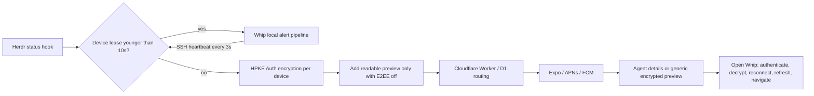

# Remote notifications and optional encryption

Remote notifications are optional for each mobile device and saved Herdr session. **End-to-end encryption (E2EE) is configurable per saved host on this device and defaults off for new registrations.** Existing registrations retain encryption until explicitly changed. With E2EE off, previews show the tab and agent name, whether the agent needs you or finished, and its task title when the hook supplies one; otherwise the body shows status, workspace and pane IDs. With E2EE on, the preview is generic and only this device can read agent details. Delivery uses Expo with **Firebase Cloud Messaging (FCM) on Android** and **Apple Push Notification service (APNs) on iOS**. Local notifications need neither the plugin nor a relay. Existing regular/persistent notifications, vibration, speech, dismissal and pane navigation still use the existing local alert pipeline.

## Components and delivery



`whip-notify/` is an independent Rust library, CLI and Herdr plugin. It has no dependency on WhipAir. Whip's Rust core imports only its cryptographic library (`default-features = false`); the host networking and filesystem implementation are excluded from mobile builds. `notify-relay/` is an independently deployable Worker with D1. No host daemon, polling service, database, or new listening port is installed.

Herdr API verification: `herdrdev/herdr` commit `a6ffef5b39b018db262f443708843dc64b15d615`, version 0.9.5, inspected on 2026-10-28. The manifest requires Herdr **0.9.5 or newer**. Whip's existing terminal protocol compatibility checks still apply independently. Older versions and missing/disabled plugins fail setup with an actionable message; local alerts keep working. Compatibility is capability checked through `plugin.list`, `plugin.action.invoke` and `plugin.log.list`, rather than assuming that an SSH connection implies plugin support.

The hook is `[[events]] on = "pane.agent_status_changed"`. Herdr 0.9.5 serializes `HERDR_PLUGIN_EVENT_JSON` as `{ "event": "pane_agent_status_changed", "data": { "type": "pane_agent_status_changed", "pane_id": "w1:p1", "workspace_id": "w1", "agent_status": "blocked", "agent": "codex" } }`. The dotted subscription and snake_case wire names differ; the test fixture was captured from a running 0.9.5 server. Context arrives separately in `HERDR_PLUGIN_CONTEXT_JSON`. Plugin paths come from `HERDR_PLUGIN_CONFIG_DIR` and `HERDR_PLUGIN_STATE_DIR`, obtained through the plugin's `paths` action over the existing authenticated Herdr connection. Paths are never guessed from a platform convention. Current Herdr shares these directories across sessions; registrations bind to `HERDR_SOCKET_PATH`, which is encrypted in the event. Register every saved session that should notify this device.

## Encryption and delivery limits

The **End-to-end encryption (E2EE)** switch is in each saved host's **Server-side push notification** section. Its choice survives app restarts and unregister/re-register cycles, and applies only to that host's registration on this device. Changing an active registration requires a connection and rechecks the pinned host identity and Herdr session. Turning encryption off is durably recorded before the host can disclose preview text; turning it on is acknowledged only after the host has stopped disclosure. An ambiguous failed update conservatively remains shown as off. Previously delivered notifications are not recalled.

Plugin 0.1.3 advertises preview support through its discovered `paths` capability. Older registrations default to encrypted when the setting is absent. Older plugins can continue encrypted delivery; plaintext previews require **Upgrade host plugin**, which replaces the managed installation while preserving its configuration. The upgrade button appears only when a connected host reports an older semantic version; current or newer versions hide it. Disconnected hosts show unknown plugin status and no install/upgrade actions until checked over SSH. The new plugin release and relay must be published/deployed before enabling previews in distributed builds.

The relay allows **at most ten outbound messages per receiving device in any rolling 60-second window**, including setup verification pushes and failed/ambiguous provider attempts. The budget uses an atomic conditional D1 insert keyed by a SHA-256 digest of the Expo token, so multiple host registrations and Worker locations share the receiving device's allowance. Accepted duplicate events do not consume another slot. Exceeding the budget returns HTTP 429 without contacting Expo; there is no delivery retry queue. Expired attempt metadata is removed by scheduled cleanup. Registration's existing per-token/IP budgets and the coarse per-IP/device Workers limiter also remain in place.

Apply `0003_device_message_rate.sql` before deploying the updated relay:

```sh
nix develop -c cf d1 migrations apply 1d31450e-7d93-4f05-95d5-ead25c1dff03 --dir notify-relay/migrations
(cd notify-relay && nix develop -c cf deploy)
```

## Leases

The host stores `$HERDR_PLUGIN_STATE_DIR/leases/<device-id>`. Files are 0600, directories 0700. The fixed version marker detects corrupt files; **mtime is the heartbeat**, set by the remote filesystem when a temporary file is created and atomically renamed. Identifiers accept 16–64 ASCII alphanumeric, underscore or hyphen characters. Symlinks, unsafe file permissions, invalid names, unreadable/missing files, corrupt markers and future mtimes do not suppress push.

A lease is valid exactly when `0 <= host_now - mtime < 10 seconds`. At ten seconds it has expired. The mobile app requests `whip-notify lease renew <device-id>` approximately every **three seconds** over its existing SSH transport; no client timestamp is sent. The CLI requires an existing registration. The hook independently checks every device, so a connected phone cannot suppress a disconnected tablet's notification.

A heartbeat requires all of:

- Remote registration enabled on this device and local alerts prepared/enabled.
- Granted OS notification permission and a mounted, executing JS notification consumer.
- A connected Rust runtime, fresh Herdr projection, active event subscription and event sink.
- iOS: foreground execution. Android: foreground execution, or the existing foreground monitoring service **and an executing JS timer**. The native service flag alone is insufficient; Rust also verifies runtime health.

JS runs one shared heartbeat timer only while registrations exist. Expensive cryptography, SSH, event processing and lease validation remain in Rust. No background JS task is needed for remote notification display. Android timer suspension or iOS backgrounding stops renewal; process termination necessarily stops it. Unmount, disabled alerts, permission loss, disconnection and event stream failure also stop renewals. An in-flight renewal may finish as the consumer stops.

**Crash window:** a renewal immediately before a crash can suppress remote push for the remaining lease lifetime, up to ten seconds (plus in-flight transport timing). A lease does not acknowledge delivery. Selection races can also cause local/remote duplicates. This is best effort, without an exactly-once or distributed acknowledgment protocol. Local monitoring settings do not revoke an opted-in remote registration; use its Unregister control to stop remote delivery.

Hooks process at most 32 registered devices, with four concurrent outbound HTTPS requests and a four-second aggregate network deadline. Registry updates use a bounded (200ms) advisory lock; lease renewals use independent atomic files. One device/network failure does not prevent attempts for other devices. Failed hooks return a generic error to Herdr's plugin log. There is no durable host retry queue; an outage can lose an event.

## Cryptographic trust model

HPKE RFC 9180 **Auth mode**, DHKEM(X25519, HKDF-SHA256), HKDF-SHA256, ChaCha20-Poly1305, is implemented by pinned [`hpke-rs`/RustCrypto 0.8.0](https://docs.rs/hpke-rs/0.8.0/hpke_rs/). This release updates the crypto-bigint and libcrux dependencies affected by RustSec advisories. The upstream [security advisory](https://github.com/celabshq/hpke-rs/security/advisories/GHSA-g433-pq76-6cmf) documents earlier review findings and fixes. Do not interpret upstream review as an audit of Whip's protocol or integration. Every message uses the single-shot API with a fresh encapsulation; HPKE contexts and RNGs are never cloned or reused.

Each device/session registration generates an independent notification X25519 key pair and an opaque device identity. Private keys and relay management capabilities live in the existing `react-native-keychain` platform vault, `WHEN_UNLOCKED_THIS_DEVICE_ONLY`. Notification keys are independent of SSH keys and are not backed up as SSH credentials. Reinstalling or restoring onto another device requires fresh registration.

The host has a distinct notification identity in its private configuration directory. Whip pins its public key through the authenticated SSH/Herdr connection. The relay never supplies or changes that pin. Device public keys are registered over that same SSH connection. Host identity is a SHA-256 fingerprint of its notification public key.

The versioned envelope contains an authenticated header (`version`, opaque `host_id`, `device_id`, recipient `key_id`, random `event_id`, `issued_at`), encapsulated key and ciphertext. Domain-separated HPKE info and ordered-tuple AAD bind every header field to the ciphertext and host identity. The event contains session/socket identity, pane/workspace ID, status and an optional bounded title. The routing event is always padded to 1024 bytes and encrypted so that tap authentication, replay protection and reconnect behavior work in either mode.

When E2EE is off, the host also sends a plaintext `preview` alongside that envelope. Its title follows the local notification pattern (`<tab> · <agent> needs you` or `finished`), using the hook's pane-matched context. UTF-8 titles and bodies are bounded to 160 and 320 bytes and exclude control characters. The relay forwards only those two validated strings into the system notification; it reconstructs a strict encrypted envelope for notification data and discards other caller-controlled fields. The preview is readable by the relay, Expo and APNs/FCM, and is not authenticated by the encrypted envelope. Tapping still requires successful envelope authentication. With E2EE on, the host omits the preview entirely; the relay sends `Whip` / `An agent has an update. Open Whip to view it.`

The device verifies the pinned host, recipient identity, key identity, AEAD authentication, session identity and event validity before navigation. It durably commits a replay ledger in Rust-owned app storage before returning a target. Authenticated event IDs remain recorded through the message's acceptance window; live IDs are never evicted to make room. A full ledger fails closed. Events expire after 24 hours and tolerate at most five minutes of future clock skew. This freshness check assumes reasonably correct wall clocks; **leases do not require clock synchronization**. Replay protection survives ordinary app restarts. Restoring an old application database on a compromised device is outside this trust boundary.

With E2EE on, the relay holds only Expo routing tokens, hashed per-device management and sending capabilities, opaque host/key/device IDs, and bounded-lived delivery IDs/provider tickets. It never has private encryption keys or SSH credentials. With E2EE off it handles plaintext preview text during delivery, without storing it in D1 or application logs. Each host sending capability authorizes only one device route; no application-wide provider credential is placed on a host. Registration is public and requires no shared enrollment code. The relay sends a random 256-bit proof only to the requested push token, bound in pending state to the device, owner, route, host and key. Only a client that receives the proof and possesses that device's management capability can activate the route. A single-use transactional confirmation expires after 120 seconds. The app listens for at most 45 seconds while explicitly enabling push and cancels on backgrounding; no background JavaScript is required. Failed verification is revoked automatically when the relay is reachable. Existing ownership tombstones prevent another client from claiming a revoked identity.

Verification pushes carry only random registration metadata and generic setup text. Whip suppresses their banner/sound while open and never treats them as agent events. If the app is backgrounded before delivery, the OS may show a generic setup notification; it cannot activate registration. The relay enforces global D1 fixed-window registration budgets of six verification pushes per Expo token and sixty per IP per minute, in addition to the existing Worker request/device limits. IPs are stored only as digests; expired proofs and budget rows are removed by the scheduled cleanup. This proves push-token possession, not app attestation or a user's real-world identity. Public endpoint abuse still needs operational monitoring and potentially additional WAF/attestation controls as traffic grows.

A malicious relay/provider can drop/delay notifications, observe timing/routing metadata, replay generic system alerts or display arbitrary generic alerts. It cannot produce an authenticated event or learn the encrypted content; it can read and alter the disclosed preview when E2EE is off. HPKE Auth is designated-recipient authentication, not a public signature/non-repudiation protocol. A compromised host can originate events; a compromised recipient can read its own notifications. Native decryption for rich previews while E2EE is on is deferred; v1 remains suitable for a future iOS notification service extension or Android native reader.

## Installation and pairing

Host details shows installation progress from Rust: checking the host, checking platform/release availability, downloading and verifying the plugin, enabling it, and verifying the result. Completed steps and elapsed time stay visible; a failure preserves the failing stage beside the error. Enabling an existing plugin skips the download steps. Progress polling stops when installation finishes, and updates from a previous host cannot appear on another host's detail screen.

1. In Whip's **Hosts** tab, open the saved host's **⋯** detail screen and find **Server-side push notification**. Connect to that host and tap **Install on host**. Relay configuration, device registration and plugin controls apply only to that saved host; general local alert preferences remain in **More → Settings → Notifications**. Whip uses that host's existing authenticated Rust SSH transport and its configured Herdr executable/session. Installation does not register a device or enable push. The host needs Herdr **0.9.5+**, Git, curl and either `sha256sum` or `shasum`. **Rust is not required.** Prebuilt releases support arm64/x86_64 Linux (static musl) and Apple Silicon macOS. Whip checks the host architecture and release availability before invoking Herdr, with a fifteen-second network probe. Unsupported hosts and unavailable releases return an error immediately after that check. Installation has a three-minute timeout and is never retried automatically; failures clear the Installing state so the user can retry. A disconnected host or unavailable plugin API is shown explicitly.

   Whip invokes Herdr's native GitHub installer at the `whip-notify-install-v<VERSION>` tag matching its compiled notification package. While connected, the detail screen shows a copyable install command for the saved host's configured Herdr executable and session, plus a [plugin source link on GitHub](https://github.com/kosumic/whip/tree/main/whip-notify). Whip runs the command over SSH and then enables the host plugin; users can also copy it to run on the host themselves. The installer tag is a separate, parentless commit containing only the plugin manifest and download scripts; Herdr fetches a few kilobytes instead of the app's source and media. The manifest's standalone `sh build.sh` downloads the matching executable and its checksum from the `whip-notify-v<VERSION>` release over HTTPS, checks the expected filename and SHA-256 digest, sets private permissions and atomically installs the executable before Herdr registers the plugin. Each download is size-limited. Checksum fetches allow fifteen seconds and binary transfers ninety seconds, without retries. Transfers below 1 KiB/s for twenty seconds fail early. Failed downloads or checksums leave any previous binary intact. There is no automatic compilation fallback. No marketplace listing is required. The equivalent manual command for the current release is:

   ```sh
   herdr plugin install --yes --ref whip-notify-install-v0.1.4 kosumic/whip/whip-notify
   ```

   Herdr's plugin registry is global to the SSH user on that host, across Herdr sessions. Whip presents controls per saved host; profiles using the same SSH account share the installation. Device/session registrations and leases remain independent. Herdr's installer retains old managed checkouts until running servers no longer need them. See [Herdr plugin installation and lifecycle](https://herdr.dev/docs/plugins/).

   The **Release notification plugin** GitHub Action (`.github/workflows/release-whip-notify.yml`) is triggered manually or by a `whip-notify-v*` tag. It validates Cargo/manifest/tag versions, checks and tests the standalone crate, builds and smoke-tests all three host targets, then publishes the minimal installer tag and complete release assets. It supports retrying an unfinished draft but refuses to replace a published release or an installer tag with different contents. Plugin releases are explicitly excluded from the app's latest-release selection. No extra release credentials are required. To publish a new version, bump `whip-notify/Cargo.toml` and `herdr-plugin.toml`, then run:

   ```sh
   gh workflow run release-whip-notify.yml --ref main
   ```

   The release must exist before clients can install that version. Checksums detect download corruption; they are fetched from the same trusted GitHub release, not independently signed. Repository/release compromise can replace both artifacts and checksums. The installer trusts the repository's HTTPS origin and maintainers.

   For development or an unsupported architecture, build/install independently from WhipAir:

   ```sh
   nix develop -c cargo build --release --locked --manifest-path whip-notify/Cargo.toml
   WHIP_NOTIFY_BINARY="$PWD/whip-notify/target/release/whip-notify" sh whip-notify/install.sh
   ```

   A standalone checkout of `whip-notify/` can use `sh build.sh && sh install.sh` to download and install without Rust. The local installer copies only the binary and manifest to `~/.local/share/whip-notify` and runs `herdr plugin link`. The binary must be beside its manifest, since commands use `./whip-notify`. Locally linked plugins can be enabled/uninstalled from Whip; Herdr refuses to overwrite a linked plugin with a GitHub installation until it is unlinked.

2. Whip uses `https://whip-notify.kosumi.dev` automatically. Users do not configure provider credentials or an enrollment code. Administrators deploy using the authenticated **cf CLI**. `notify-relay/cloudflare.config.ts` selects the production account, database and custom domain; `wrangler.jsonc` retains matching settings for existing type and packaging checks. Verify `cf auth whoami` before deploying. From this checkout, install the standalone relay's dependencies with `nix develop -c npm ci --prefix notify-relay`, then:

   ```sh
   nix develop -c cf auth whoami
   nix develop -c cf d1 migrations apply 1d31450e-7d93-4f05-95d5-ead25c1dff03 --dir notify-relay/migrations
   (cd notify-relay && nix develop -c cf deploy)
   # Optional when Expo push security is enabled for the project:
   # Use a private JSON/env file containing only EXPO_ACCESS_TOKEN.
   (cd notify-relay && nix develop -c cf deploy --secrets-file /path/to/private-relay-secrets.json)
   ```

   For another account, create a database with `cf d1 create --name whip-notify`, update the account, database and domain in both relay configurations, then apply all migrations before deploying. A custom relay can be selected per saved host. Existing registrations keep their original relay URL and must be unregistered/re-registered to move accounts; installing an updated app changes the default for new registrations only.

   D1 retains delivery IDs for at most the acceptance window, cleaned every 15 minutes; the scheduled Worker also removes expired verification state, checks Expo receipts and disables invalid provider tokens. Rate limits apply to IPs, push-token registration attempts and device routes. The relay returns 503 for upstream/network failures. Use a separate database when deploying another environment. Protocol 2 requires migration `0002_public_registration.sql`; apply it before deploying. Existing protocol 1 routes continue working, but old apps receive 426 when creating registrations and must update. Remove the obsolete `ENROLLMENT_TOKEN` Worker secret after deployment; the former private workstation enrollment file is no longer used.

3. Configure the mobile distribution's **Expo project**, APNs and FCM credentials. The existing project ID is in `app.json`; upload APNs and FCM v1 sending credentials to that Expo project with `eas credentials` (provider secrets remain at Expo). Enable Push Notifications for the Apple app identifier and refresh provisioning profiles. Native iOS entitlements select development APNs for Debug and production for Release. Android needs Firebase's client `google-services.json` for `io.github.kaminarios.whip`; place it at `android/app/google-services.json` or set `WHIP_GOOGLE_SERVICES_JSON` to its path for Gradle/EAS. Builds without Firebase client config retain local notifications; remote setup reports the provider configuration failure. Rebuild the native app, arm64 only, using the normal upload signing and GitHub distribution channel for local installs. Never uninstall to resolve a signing mismatch.

   `WHIP_NOTIFY_RELAY_URL` can set the initial relay URL in app config. Remote notifications cannot work in an already installed build lacking the new Rust/native bridge and push provisioning. Cloudflare credentials alone cannot create APNs/FCM credentials.

   Current maintainer configuration (2026-10-28):

   - Firebase project [`whip-64328`](https://console.firebase.google.com/project/whip-64328/overview), sender ID `759812906515`, registers the current Android package. Analytics and Gemini were disabled during creation; the project uses the free Spark plan. A dedicated `whip-expo-push` service account has the project-scoped Firebase Cloud Messaging API Admin role, rather than project Owner/Editor or Firebase Admin. Its FCM v1 sending key is stored in Expo for `io.github.kaminarios.whip`. The legacy `dev.herdr.remote` Expo credential record is retained separately.
   - The local Firebase client file is ignored at `android/app/google-services.json`. EAS has a secret file variable named `WHIP_GOOGLE_SERVICES_JSON` in production, preview and development. GitHub's protected `google-play` environment has `GOOGLE_SERVICES_JSON` containing this client configuration; the APK and Play workflows run `scripts/prepare-firebase-android.cjs` before Gradle. The helper rejects service-account private keys and mismatched package identifiers. To configure a replacement project, set this GitHub secret from the new client file and update the EAS file variable. A missing secret preserves optional local-only builds.
   - Apple's Whip app identifier has Push Notifications enabled. Expo's existing APNs key supports sandbox and production. Its App Store profile was regenerated with the same distribution certificate, verified to contain the production push entitlement and correct app/team identity, and uploaded back to Expo. Local Xcode development builds must obtain a fresh development profile through normal automatic signing.
   - Direct iPad installs on `mini` also have a separate push-enabled development profile, `Whip Push iPad Development 2026-10-28`, using its existing development certificate and the registered iPad mini. The ignored backup is `.eas-secrets/WhipPushDevelopment.mobileprovision`; Xcode stores the installed profile under `~/Library/Developer/Xcode/UserData/Provisioning Profiles/<UUID>.mobileprovision`. A development-signed local Release build must use `WHIP_APS_ENVIRONMENT = development`. If Xcode has no Apple account, select this profile manually for the local app target. Keep these machine-specific signing overrides out of Git and retain production APNs for App Store distribution.
   - Private FCM sending credentials are kept in Expo; the temporary local key file was removed after verifying the uploaded key and Google authentication. They must never enter the Android client config, app bundle, Git, relay, or Herdr host. For rotation, create/upload a replacement before revoking the previous Google key. The renewed local App Store profile is in the ignored `.eas-secrets/WhipPush.mobileprovision`. No signing certificate was replaced.

   Google service-account authentication and an FCM validate-only preflight passed. The arm64 Android release Google Services task passed; delivery to an Android device has not been tested. Real Expo/APNs sandbox delivery and cold-launch navigation passed on the arm64 iOS 26.5 simulator on `mini`, as recorded below. Provider credential setup used OpenCLI for Firebase/Apple browser configuration and downloads, and the existing authenticated Expo CLI/API session for credential storage.

4. In that host's detail screen, connect to the host and select **Enable / rotate keys**. Keep Whip open during automatic push verification. Setup discovers plugin paths and host identity over SSH, commits device keys before remote registration, verifies the receiving push token, authorizes the isolated relay route, then registers the public key with the host. Choose this host’s E2EE setting before or after registration; new hosts default off. **Custom relay** is optional and only changes this host's relay origin.

5. **Unregister** stops push for this device, revokes the relay route, unregisters the device on the host and removes local keys after relay revocation. If SSH is offline, cleanup is retained and applied on the next connection. If the relay is offline, Whip immediately stops accepting old ciphertext/renewing leases and keeps the management capability for a retry; retry Unregister to finish revocation. Only necessary pending host cleanup is retained. To rotate device keys, finish Unregister, then Enable again. Other devices are unaffected. Remove a registration before deleting its saved host.

6. **Unregister** affects this device's registration on the selected host. **Uninstall from host** first unregisters this device, then invokes Herdr's `plugin.unlink` API for that SSH account, stopping future hooks across its sessions and devices. If relay revocation fails, Whip still uninstalls the host plugin, disables local acceptance/leases, and retains management credentials for an explicit Unregister retry. Other hosts are unaffected. Uninstall preserves the host identity and other device registrations, matching Herdr's lifecycle; a reinstall can resume their delivery. GitHub-managed installation files are reclaimed by Herdr when no running server needs them; locally linked installation files remain user-owned.

   The manual equivalent is `herdr plugin uninstall dev.whip.notify`. For permanent data removal, administrators can explicitly run `whip-notify --dirs <config-dir> <state-dir> uninstall` after unlinking, then remove a local installation directory. Deleting the host identity requires every device to pair again; never silently repin a changed identity.

   Marketplace discovery is optional: after merging the manifest onto the public repository's default branch, add the GitHub topic `herdr-plugin`. Herdr indexes the repository and its `whip-notify/` subdirectory automatically; this is discovery, not a security review. See [Herdr marketplace publishing](https://herdr.dev/docs/marketplace/).

## Validation

`nix develop -c cargo test --locked --manifest-path whip-notify/Cargo.toml` covers real CLI hook execution, simulated delivery with real HPKE decryption, status filtering, lease boundaries/corruption/future mtimes, concurrent hooks/renewals, independent devices/sessions, key substitution, forgery, tampering, replay persistence, rotation, revocation and network failure. The app Rust core tests and strict Clippy checks run separately.

Preview tests cover per-host defaults and persistence, encrypted legacy registrations, failed setting updates, pane-matched context, Unicode bounds, unchanged authenticated routing, and generic versus readable system text. The relay tests exercise rolling-window boundaries, shared receiving-device budgets across host registrations, independent devices, failed provider attempts, duplicate events, and concurrent sends in the actual Workers runtime.

`nix develop -c npm test -- --runInBand` includes relay integration against real in-memory SQLite with mocked Expo, registration lifecycle, provider receipts/revocation, token rotation races, cold-launch/disconnected routing, mobile heartbeat readiness, iOS suspension/Android service behavior, and the existing local alert suite. The Miniflare test additionally executes enrollment, ciphertext routing, revocation and redirect rejection in the actual Workers runtime. `npm run notify:check` checks Worker types and deploy packaging. Acceptance testing requires correctly provisioned native builds and real provider delivery: kill/suspend the app, wait ten seconds, transition an agent to blocked/done, open the generic system alert and verify fresh pane navigation. Modern APNs-capable iOS simulators can run this test; `simctl push` alone does not exercise Expo/APNs. Whip explicitly registers simulator tokens for the APNs sandbox because simulator builds lack the provisioning profile Expo uses to infer that environment. Physical iOS and Android acceptance testing remain separate checks. Also test an Android OS force-stop: Android intentionally blocks push to force-stopped apps until they are manually opened.

Remote OS notification triggers must carry the encrypted envelope; plaintext push data that imitates a local notification is rejected. After reconnecting, Whip checks the host notification identity and session again over SSH before refreshing/navigating, including when a saved profile was edited. A replaced connection aborts navigation.

Android can sometimes deliver event callbacks while delaying JS timers. In that case leases fail open to remote delivery and a local alert can also appear. OS scheduling, provider failures and expired/closed pane targets remain best-effort limitations.

## Verification results (2026-10-28)

- Rust core: 873 passed, 7 existing ignored tests; the live OpenSSH feature matrix also passed separately, including private stdin delivery. Installer tests execute the selected host/session command with adversarial shell arguments.
- Standalone plugin: 15 tests passed, including the real Herdr 0.9.5 wire fixture and binary installer; strict Clippy and formatting passed. Native notification/installer/replay regression checks passed 7 tests after the 0.1.2 version update. The GitHub release workflow passed verification, both ARM64 builds and publication of [0.1.2 binaries and checksums](https://github.com/kosumic/whip/releases/tag/whip-notify-v0.1.2).
- JavaScript: 245 suites / 3,159 tests passed, including automatic push-token ownership checks, single-use/expired/cross-device proofs, concurrent confirmation/revocation, public registration budgets, local alert preservation, encrypted response admission, host/session replacement rejection and per-host plugin setup. The real Workers runtime test covers the unsupported `redirect: "error"` regression; provider requests use `manual` and reject redirects without forwarding credentials. Push-token refresh completes ownership verification before replacing relay routing.
- Application/Worker TypeScript, ESLint, script/version checks, Expo Doctor (19/19), Worker packaging and generated license checks passed.
- Android: arm64 Rust compilation, debug APK assembly and release lint passed. No app was uninstalled or installed on a device.
- iOS: arm64 iPhone 17 Pro simulator, iOS 26.5, system Xcode 27.1 on Apple Silicon `mini`. A real Herdr 0.9.5 named session and the patched 0.1.2 plugin sent encrypted blocked events through the deployed Cloudflare relay, Expo and APNs sandbox. Automatic ownership verification succeeded. With Whip terminated, iOS displayed the generic banner; opening it authenticated/decrypted the event, durably recorded its replay receipt, reconnected and selected the correct terminal. A passing XCTest changed the tab label after push delivery and verified the new label after cold launch, proving a fresh snapshot. No `simctl push` was used. The live test exercised blocked events; done filtering and encryption are covered by automated hook tests. Physical iOS and Android delivery were not tested.
- Physical iPad installation: Whip 1.10.0 from `fafac07b` built successfully with system Xcode 27.1 and installed in place on an iPad mini (6th generation), iPadOS 26.6. Strict code-signature validation, thin ARM64 architecture, unchanged application identity, development APNs entitlement, embedded commit and GitHub channel checks passed. The new development profile includes the iPad and the existing certificate. No app was uninstalled; the reused checkout's original changes were restored exactly afterward. Automatic launch was blocked by the locked iPad. Physical-device push delivery remains untested.
- Live leases: host mtimes advanced by three seconds while Whip was active, with a 21-byte marker and mode 0600. A blocked hook under a fresh lease completed without a remote delivery. On iOS backgrounding, the mtime stopped advancing; after expiration, the next blocked hook produced another real APNs alert. Relay delivery counts were consistent with suppression/resumption. The final cold-launch and background XCTest cases passed.
- The managed relay's additive protocol 2 migration and Worker update were deployed. Its health endpoint returned protocol 2 / envelope 1; legacy enrollment was rejected with 426 and an unproven confirmation with 403, without sending a push. The obsolete shared enrollment secret was removed from the Worker.

Per-host setup tests also exercise the actual install/uninstall UI, disabled controls for disconnected/unsupported hosts, host isolation, relay-outage cleanup across reconnection and credential-vault failures. The standalone Herdr build script was run successfully. The existing Android/iOS build results above predate these setup controls; the controls were checked with Rust/TypeScript/tests, without another native device build.

The live test used a separate Herdr binary, private configuration/state and one temporary saved host. The original simulator data and Keychain were preserved. Normal application APIs removed the temporary registration and host; independent checks confirmed empty host registration/lease state and no active test relay route. The normal app entry point and original four saved hosts were restored, and the isolated Herdr session was stopped. Hook debugging exposed the dotted subscription versus snake_case envelope difference, fixed in plugin 0.1.2. Private routing tokens, encryption keys and verification proofs are excluded from screenshots and published test results.

### Plugin 0.1.3 and kosumi.dev rollout (2026-10-28)

- Published [plugin 0.1.3](https://github.com/kosumic/whip/releases/tag/whip-notify-v0.1.3), including both ARM64 binaries and checksums, after the release workflow passed verification and builds.
- Used the authenticated `cf` CLI to create the relay database in the account owning `kosumi.dev`, apply all three migrations, and deploy `https://whip-notify.kosumi.dev`. HTTPS health returned `{"ok":true,"protocol":2,"envelope":1}`. Expo credentials were confirmed as a Worker secret; the temporary deployment credential file was removed.
- The preview/encryption changes passed 98 JavaScript tests, 17 standalone plugin/installer Rust tests and two native installer tests. Application and relay types, targeted strict lint, formatting, Clippy and packaging checks passed. A further 26 relay tests passed after the account/domain change, including the actual Workers runtime and rolling device budget.
- Built and installed Whip 1.10.0 (234), source `05537a44`, on the connected Pixel 9 Pro using the GitHub channel and upload signing. The APK contained only ARM64 native libraries and the new relay default. Its signing certificate matched the existing installation; Android retained the original installation timestamp and notification permission. The updated process ran without native/JavaScript errors in the inspected launch logs. Physical push delivery and the device settings UI were not exercised in this rollout.

The subsequent host-detail fix shows **Upgrade host plugin** only for an older installed semantic version, and hides it after upgrading or when a current/newer version is discovered. Unknown/disconnected status no longer presents an installation action. Eleven UI tests, three native installer/version tests, TypeScript and strict targeted lint passed. The working-tree build on local `main` was verified for upload signing, ARM64, the relay default and the bundled UI changes, then installed in place on the same phone. After a streamed install returned an empty error, `adb install --no-streaming -r` succeeded.
