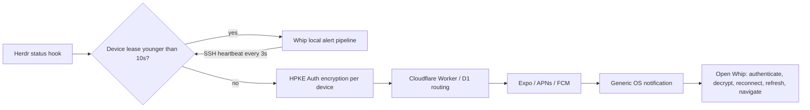

# Encrypted remote notifications

Remote notifications are optional for each mobile device and saved Herdr session. Local notifications need neither the plugin nor a relay. Existing regular/persistent notifications, vibration, speech, dismissal and pane navigation still use the existing local alert pipeline.

## Components and delivery



`whip-notify/` is an independent Rust library, CLI and Herdr plugin. It has no dependency on WhipAir. Whip's Rust core imports only its cryptographic library (`default-features = false`); the host networking and filesystem implementation are excluded from mobile builds. `notify-relay/` is an independently deployable Worker with D1. No host daemon, polling service, database, or new listening port is installed.

Herdr API verification: `herdrdev/herdr` commit `a6ffef5b39b018db262f443708843dc64b15d615`, version 0.9.5, inspected on 2026-10-28. The manifest requires Herdr **0.9.5 or newer**. Whip's existing terminal protocol compatibility checks still apply independently. Older versions and missing/disabled plugins fail setup with an actionable message; local alerts keep working. Compatibility is capability checked through `plugin.list`, `plugin.action.invoke` and `plugin.log.list`, rather than assuming that an SSH connection implies plugin support.

The hook is `[[events]] on = "pane.agent_status_changed"`. `HERDR_PLUGIN_EVENT_JSON` is `{ "event": "pane.agent_status_changed", "data": { "pane_id": "w1:p1", "workspace_id": "w1", "agent_status": "blocked", "title": "..." } }`. Context arrives separately in `HERDR_PLUGIN_CONTEXT_JSON`. Plugin paths come from `HERDR_PLUGIN_CONFIG_DIR` and `HERDR_PLUGIN_STATE_DIR`, obtained through the plugin's `paths` action over the existing authenticated Herdr connection. Paths are never guessed from a platform convention. Current Herdr shares these directories across sessions; registrations bind to `HERDR_SOCKET_PATH`, which is encrypted in the event. Register every saved session that should notify this device.

## Leases

The host stores `$HERDR_PLUGIN_STATE_DIR/leases/<device-id>`. Files are 0600, directories 0700. The fixed version marker detects corrupt files; **mtime is the heartbeat**, set by the remote filesystem when a temporary file is created and atomically renamed. Identifiers accept 16–64 ASCII alphanumeric, underscore or hyphen characters. Symlinks, unsafe file permissions, invalid names, unreadable/missing files, corrupt markers and future mtimes do not suppress push.

A lease is valid exactly when `0 <= host_now - mtime < 10 seconds`. At ten seconds it has expired. The mobile app requests `whip-notify lease renew <device-id>` approximately every **three seconds** over its existing SSH transport; no client timestamp is sent. The CLI requires an existing registration. The hook independently checks every device, so a connected phone cannot suppress a disconnected tablet's notification.

A heartbeat requires all of:

- Remote registration enabled on this device and local alerts prepared/enabled.
- Granted OS notification permission and a mounted, executing JS notification consumer.
- A connected Rust runtime, fresh Herdr projection, active event subscription and event sink.
- iOS: foreground execution. Android: foreground execution, or the existing foreground monitoring service **and an executing JS timer**. The native service flag alone is insufficient; Rust also verifies runtime health.

JS runs one shared heartbeat timer only while registrations exist. Expensive cryptography, SSH, event processing and lease validation remain in Rust. No background JS task is needed for remote notification display. Android timer suspension or iOS backgrounding stops renewal; process termination necessarily stops it. Unmount, disabled alerts, permission loss, disconnection and event stream failure also stop renewals. An in-flight renewal may finish as the consumer stops.

**Crash window:** a renewal immediately before a crash can suppress remote push for the remaining lease lifetime, up to ten seconds (plus in-flight transport timing). A lease does not acknowledge delivery. Selection races can also cause local/remote duplicates. This is best effort, without an exactly-once or distributed acknowledgment protocol. Local monitoring settings do not revoke an opted-in remote registration; use its Disable/Unregister control to stop remote delivery.

Hooks process at most 32 registered devices, with four concurrent outbound HTTPS requests and a four-second aggregate network deadline. Registry updates use a bounded (200ms) advisory lock; lease renewals use independent atomic files. One device/network failure does not prevent attempts for other devices. Failed hooks return a generic error to Herdr's plugin log. There is no durable host retry queue; an outage can lose an event.

## Cryptographic trust model

HPKE RFC 9180 **Auth mode**, DHKEM(X25519, HKDF-SHA256), HKDF-SHA256, ChaCha20-Poly1305, is implemented by pinned `hpke-rs`/RustCrypto 0.6.1. This is an established implementation that underwent external security research/review; 0.6.1 includes the fixes following that review. The upstream [security advisory](https://github.com/celabshq/hpke-rs/security/advisories/GHSA-g433-pq76-6cmf) and [changelog](https://github.com/celabshq/hpke-rs/blob/main/CHANGELOG.md) describe the changes. Do not interpret upstream review as an audit of Whip's protocol or integration. Every message uses the single-shot API with a fresh encapsulation; HPKE contexts and RNGs are never cloned or reused.

Each device/session registration generates an independent notification X25519 key pair and an opaque device identity. Private keys and relay management capabilities live in the existing `react-native-keychain` platform vault, `WHEN_UNLOCKED_THIS_DEVICE_ONLY`. Notification keys are independent of SSH keys and are not backed up as SSH credentials. Reinstalling or restoring onto another device requires fresh registration.

The host has a distinct notification identity in its private configuration directory. Whip pins its public key through the authenticated SSH/Herdr connection. The relay never supplies or changes that pin. Device public keys are registered over that same SSH connection. Host identity is a SHA-256 fingerprint of its notification public key.

The versioned envelope contains an authenticated header (`version`, opaque `host_id`, `device_id`, recipient `key_id`, random `event_id`, `issued_at`), encapsulated key and ciphertext. Domain-separated HPKE info and ordered-tuple AAD bind every header field to the ciphertext and host identity. The event contains session/socket identity, pane/workspace ID, status and an optional bounded title. Plaintext is padded to 1024 bytes, encrypted, and only then sent to the relay. The relay reconstructs a strict envelope and never forwards caller-controlled plaintext notification fields.

The device verifies the pinned host, recipient identity, key identity, AEAD authentication, session identity and event validity before navigation. It durably commits a replay ledger in Rust-owned app storage before returning a target. Authenticated event IDs remain recorded through the message's acceptance window; live IDs are never evicted to make room. A full ledger fails closed. Events expire after 24 hours and tolerate at most five minutes of future clock skew. This freshness check assumes reasonably correct wall clocks; **leases do not require clock synchronization**. Replay protection survives ordinary app restarts. Restoring an old application database on a compromised device is outside this trust boundary.

The relay holds only Expo routing tokens, hashed per-device management and sending capabilities, opaque host/key/device IDs, and bounded-lived delivery IDs/provider tickets. It has no notification plaintext, private encryption keys or SSH credentials. Each host sending capability authorizes only one device route; no application-wide provider credential is placed on a host. Registration is public and requires no shared enrollment code. The relay sends a random 256-bit proof only to the requested push token, bound in pending state to the device, owner, route, host and key. Only a client that receives the proof and possesses that device's management capability can activate the route. A single-use transactional confirmation expires after 120 seconds. The app listens for at most 45 seconds while explicitly enabling push and cancels on backgrounding; no background JavaScript is required. Failed verification is revoked automatically when the relay is reachable. Existing ownership tombstones prevent another client from claiming a revoked identity.

Verification pushes carry only random registration metadata and generic setup text. Whip suppresses their banner/sound while open and never treats them as agent events. If the app is backgrounded before delivery, the OS may show a generic setup notification; it cannot activate registration. The relay enforces global D1 fixed-window registration budgets of six verification pushes per Expo token and sixty per IP per minute, in addition to the existing Worker request/device limits. IPs are stored only as digests; expired proofs and budget rows are removed by the scheduled cleanup. This proves push-token possession, not app attestation or a user's real-world identity. Public endpoint abuse still needs operational monitoring and potentially additional WAF/attestation controls as traffic grows.

A malicious relay/provider can drop/delay notifications, observe timing/routing metadata, replay generic system alerts or display arbitrary generic alerts. It cannot produce an authenticated event or learn the encrypted content. HPKE Auth is designated-recipient authentication, not a public signature/non-repudiation protocol. A compromised host can originate events; a compromised recipient can read its own notifications. Rich native previews/decryption are deferred; v1 remains suitable for a future iOS notification service extension or Android native reader.

## Installation and pairing

1. In Whip's **Hosts** tab, open the saved host's **⋯** detail screen and find **Encrypted remote notifications**. Connect to that host and tap **Install on host**. Relay configuration, device registration and plugin controls apply only to that saved host; general local alert preferences remain in **More → Settings → Notifications**. Whip uses that host's existing authenticated Rust SSH transport and its configured Herdr executable/session. Installation does not register a device or enable push. The host needs Herdr **0.9.5+**, Git and a current stable Rust toolchain (including any toolchain pinned by the checkout). The first release build can take several minutes; installation has a twenty-minute timeout and is never retried automatically. A disconnected host or unavailable plugin API is shown explicitly.

   Whip invokes Herdr's native GitHub installer, which clones this repository, runs the manifest's standalone `sh build.sh`, then registers the plugin only after a successful build. This works once this feature is published to the repository's default branch. No marketplace listing is required. The equivalent manual command is:

   ```sh
   herdr plugin install --yes KaminariOS/whip/whip-notify
   ```

   Herdr's plugin registry is global to the SSH user on that host, across Herdr sessions. Whip presents controls per saved host; profiles using the same SSH account share the installation. Device/session registrations and leases remain independent. Herdr's installer retains old managed checkouts until running servers no longer need them. See [Herdr plugin installation and lifecycle](https://herdr.dev/docs/plugins/).

   To use this unpublished working tree instead, build/install independently from WhipAir:

   ```sh
   nix develop -c cargo build --release --locked --manifest-path whip-notify/Cargo.toml
   sh whip-notify/install.sh
   ```

   A standalone checkout of `whip-notify/` can instead use `sh build.sh` with a suitable Rust toolchain. The local installer copies only the binary and manifest to `~/.local/share/whip-notify` and runs `herdr plugin link`. The binary must be beside its manifest, since commands use `./whip-notify`. Locally linked plugins can be enabled/uninstalled from Whip; Herdr refuses to overwrite a linked plugin with a GitHub installation until it is unlinked.

2. Whip uses `https://whip-notify.limin-035.workers.dev` automatically. Users do not configure provider credentials or an enrollment code. Administrators can deploy a different relay and select it under **Custom relay** in the host's detail screen. From this checkout (or run equivalent Wrangler commands inside `notify-relay/` after `npm install`):

   ```sh
   nix develop -c npx wrangler d1 create whip-notify --config notify-relay/wrangler.jsonc --binding DB --update-config
   nix develop -c npx wrangler d1 migrations apply whip-notify --remote --config notify-relay/wrangler.jsonc
   nix develop -c npx wrangler deploy --config notify-relay/wrangler.jsonc
   # Optional when Expo push security is enabled for the project:
   nix develop -c npx wrangler secret put EXPO_ACCESS_TOKEN --config notify-relay/wrangler.jsonc
   ```

   D1 retains delivery IDs for at most the acceptance window, cleaned every 15 minutes; the scheduled Worker also removes expired verification state, checks Expo receipts and disables invalid provider tokens. Rate limits apply to IPs, push-token registration attempts and device routes. The relay returns 503 for upstream/network failures. Use a separate database when deploying another environment. Protocol 2 requires migration `0002_public_registration.sql`; apply it before deploying. Existing protocol 1 routes continue working, but old apps receive 426 when creating registrations and must update. Remove the obsolete `ENROLLMENT_TOKEN` Worker secret after deployment; the former private workstation enrollment file is no longer used.

3. Configure the mobile distribution's **Expo project**, APNs and FCM credentials. The existing project ID is in `app.json`; upload APNs and FCM v1 sending credentials to that Expo project with `eas credentials` (provider secrets remain at Expo). Enable Push Notifications for the Apple app identifier and refresh provisioning profiles. Native iOS entitlements select development APNs for Debug and production for Release. Android needs Firebase's client `google-services.json` for `io.github.kaminarios.whip`; place it at `android/app/google-services.json` or set `WHIP_GOOGLE_SERVICES_JSON` to its path for Gradle/EAS. Builds without Firebase client config retain local notifications; remote setup reports the provider configuration failure. Rebuild the native app, arm64 only, using the normal upload signing and GitHub distribution channel for local installs. Never uninstall to resolve a signing mismatch.

   `WHIP_NOTIFY_RELAY_URL` can set the initial relay URL in app config. Remote notifications cannot work in an already installed build lacking the new Rust/native bridge and push provisioning. Cloudflare credentials alone cannot create APNs/FCM credentials.

   Current maintainer configuration (2026-10-28):

   - Firebase project [`whip-64328`](https://console.firebase.google.com/project/whip-64328/overview), sender ID `759812906515`, registers the current Android package. Analytics and Gemini were disabled during creation; the project uses the free Spark plan. A dedicated `whip-expo-push` service account has the project-scoped Firebase Cloud Messaging API Admin role, rather than project Owner/Editor or Firebase Admin. Its FCM v1 sending key is stored in Expo for `io.github.kaminarios.whip`. The legacy `dev.herdr.remote` Expo credential record is retained separately.
   - The local Firebase client file is ignored at `android/app/google-services.json`. EAS has a secret file variable named `WHIP_GOOGLE_SERVICES_JSON` in production, preview and development. GitHub's protected `google-play` environment has `GOOGLE_SERVICES_JSON` containing this client configuration; the APK and Play workflows run `scripts/prepare-firebase-android.cjs` before Gradle. The helper rejects service-account private keys and mismatched package identifiers. To configure a replacement project, set this GitHub secret from the new client file and update the EAS file variable. A missing secret preserves optional local-only builds.
   - Apple's Whip app identifier has Push Notifications enabled. Expo's existing APNs key supports sandbox and production. Its App Store profile was regenerated with the same distribution certificate, verified to contain the production push entitlement and correct app/team identity, and uploaded back to Expo. Local Xcode development builds must obtain a fresh development profile through normal automatic signing.
   - Private FCM sending credentials are kept in Expo; the temporary local key file was removed after verifying the uploaded key and Google authentication. They must never enter the Android client config, app bundle, Git, relay, or Herdr host. For rotation, create/upload a replacement before revoking the previous Google key. The renewed local App Store profile is in the ignored `.eas-secrets/WhipPush.mobileprovision`. No signing certificate was replaced.

   Google service-account authentication and an FCM validate-only preflight passed; no device notification was sent. The arm64 Android release Google Services task passed. A rebuilt native app and a physical-device push/navigation test are still required before claiming delivery works on a particular device. Provider credential setup used OpenCLI for Firebase/Apple browser configuration and downloads, and the existing authenticated Expo CLI/API session for credential storage.

4. In that host's detail screen, connect to the host and select **Enable / rotate keys**. Keep Whip open during automatic push verification. Setup discovers plugin paths and host identity over SSH, commits device keys before remote registration, verifies the receiving push token, authorizes the isolated relay route, then registers the public key with the host. No code or notification mode switch is needed. **Custom relay** is optional and only changes this host's relay origin.

5. **Disable** revokes the relay route and unregisters the device on the host. If SSH is offline, cleanup is retained and applied on the next connection. If the relay is offline, Whip immediately stops accepting old ciphertext/renewing leases and keeps the management capability for a retry; retry Disable/Unregister to finish revocation. **Unregister** also removes local keys after relay revocation, retaining only necessary pending host cleanup. To rotate device keys, finish Disable, then Enable again. Other devices are unaffected. Remove a registration before deleting its saved host.

6. **Disable** and **Unregister** affect this device's registration on the selected host. **Uninstall from host** first disables/unregisters this device, then invokes Herdr's `plugin.unlink` API for that SSH account, stopping future hooks across its sessions and devices. If relay revocation fails, Whip still uninstalls the host plugin, disables local acceptance/leases, and retains management credentials for an explicit Unregister retry. Other hosts are unaffected. Uninstall preserves the host identity and other device registrations, matching Herdr's lifecycle; a reinstall can resume their delivery. GitHub-managed installation files are reclaimed by Herdr when no running server needs them; locally linked installation files remain user-owned.

   The manual equivalent is `herdr plugin uninstall dev.whip.notify`. For permanent data removal, administrators can explicitly run `whip-notify --dirs <config-dir> <state-dir> uninstall` after unlinking, then remove a local installation directory. Deleting the host identity requires every device to pair again; never silently repin a changed identity.

   Marketplace discovery is optional: after merging the manifest onto the public repository's default branch, add the GitHub topic `herdr-plugin`. Herdr indexes the repository and its `whip-notify/` subdirectory automatically; this is discovery, not a security review. See [Herdr marketplace publishing](https://herdr.dev/docs/marketplace/).

## Validation

`nix develop -c cargo test --locked --manifest-path whip-notify/Cargo.toml` covers real CLI hook execution, simulated delivery with real HPKE decryption, status filtering, lease boundaries/corruption/future mtimes, concurrent hooks/renewals, independent devices/sessions, key substitution, forgery, tampering, replay persistence, rotation, revocation and network failure. The app Rust core tests and strict Clippy checks run separately.

`nix develop -c npm test -- --runInBand` includes relay integration against real in-memory SQLite with mocked Expo, registration lifecycle, provider receipts/revocation, token rotation races, cold-launch/disconnected routing, mobile heartbeat readiness, iOS suspension/Android service behavior, and the existing local alert suite. `npm run notify:check` checks Worker types and deploy packaging. Real APNs/FCM delivery still requires correctly provisioned native builds and physical-device acceptance testing: kill/suspend the app, wait ten seconds, transition a real agent to blocked/done, tap the generic system alert and verify fresh pane navigation. Also test an Android OS force-stop: Android intentionally blocks push to force-stopped apps until they are manually opened.

Remote OS notification triggers must carry the encrypted envelope; plaintext push data that imitates a local notification is rejected. After reconnecting, Whip checks the host notification identity and session again over SSH before refreshing/navigating, including when a saved profile was edited. A replaced connection aborts navigation.

Android can sometimes deliver event callbacks while delaying JS timers. In that case leases fail open to remote delivery and a local alert can also appear. OS scheduling, provider failures and expired/closed pane targets remain best-effort limitations.

## Verification results (2026-10-28)

- Rust core: 873 passed, 7 existing ignored tests; the live OpenSSH feature matrix also passed separately, including private stdin delivery. Installer tests execute the selected host/session command with adversarial shell arguments.
- Standalone plugin: 8 tests passed; release binary built; strict Clippy, formatting and crypto-only library checks passed.
- JavaScript: 244 suites / 3,154 tests passed, including automatic push-token ownership checks, single-use/expired/cross-device proofs, concurrent confirmation/revocation, public registration budgets, local alert preservation, encrypted response admission, host/session replacement rejection and per-host plugin setup. The final targeted notification suite passed 65 tests.
- Application/Worker TypeScript, ESLint, script/version checks, Expo Doctor (19/19), Worker packaging and generated license checks passed.
- Android: arm64 Rust compilation, debug APK assembly and release lint passed. No app was uninstalled or installed on a device.
- iOS: arm64 simulator native build, production JavaScript bundle and actual host-detail UI capture passed. The simulator confirms that only the selected host's controls appear and the enrollment-code field is absent. APNs/FCM provider credentials and the production push profile are configured as described above. A native Apple device build and real APNs/FCM delivery acceptance test were not run; rebuilt apps and device opt-in are still required.
- The managed relay's additive protocol 2 migration and Worker update were deployed. Its health endpoint returned protocol 2 / envelope 1; legacy enrollment was rejected with 426 and an unproven confirmation with 403, without sending a push. The obsolete shared enrollment secret was removed from the Worker.

Per-host setup tests also exercise the actual install/uninstall UI, disabled controls for disconnected/unsupported hosts, host isolation, relay-outage cleanup across reconnection and credential-vault failures. The standalone Herdr build script was run successfully. The existing Android/iOS build results above predate these setup controls; the controls were checked with Rust/TypeScript/tests, without another native device build.
